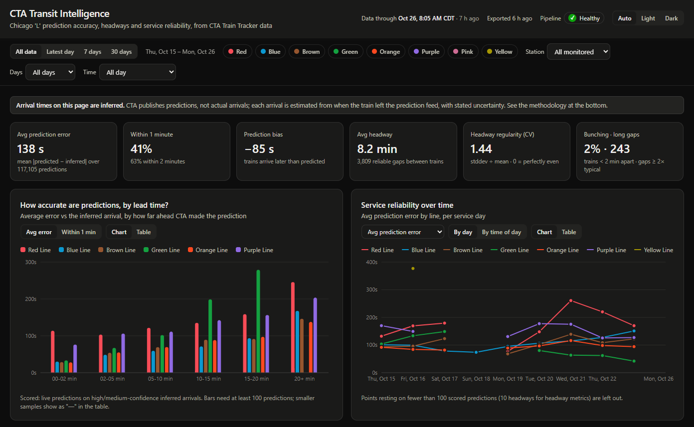
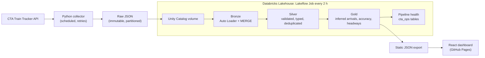

# CTA Transit Intelligence Platform

[](https://github.com/wheattthins/CTA-Transit-Intelligence-Platform/actions/workflows/ci.yml)
[](https://github.com/wheattthins/CTA-Transit-Intelligence-Platform/actions/workflows/dashboard.yml)
[](LICENSE)

**How accurate are the CTA's train arrival predictions, and how reliable is 'L' service, really?**

The CTA publishes *predictions* of when trains will arrive, but never reports when they actually
did. This project collects every prediction, **infers real arrival times** from the feed, and runs
the data through an automated Databricks lakehouse to measure prediction accuracy, headways,
bunching and service gaps, all shown on an interactive dashboard.

<!-- TODO(launch): live dashboard link: https://wheattthins.github.io/CTA-Transit-Intelligence-Platform/ -->
<!-- TODO(launch): dashboard screenshot or GIF, e.g.  -->
<!-- TODO(launch): paste the dashboard URL into https://www.linkedin.com/post-inspector/ to check
     the preview card (frontend/index.html og: tags) and refresh LinkedIn's cache before posting. -->

## Key findings

<!-- TODO(launch): fill in after 2–4 weeks of continuous collection. Lead with numbers, e.g.
- Predictions 10+ minutes out are off by X min on average; under 2 minutes, by Y s.
- The <line> Line has the most bunching: Z% of headways under 2 minutes at rush hour.
- Unexpected service gaps (≥ 2× the typical headway) happen N times per day at <station>.
State the sample size (days, stations, trains) alongside each finding. -->

*Based on N days of data across N stations (N train arrivals inferred).*

## How it works



Collection runs **outside** Databricks, because Databricks Free Edition restricts outbound internet
access. The collector and the Databricks Job are connected only through the landing volume, so if
either one is down the other keeps working, and files simply wait to be processed.

## Engineering highlights

- **Measuring what the API never reports.** CTA only publishes predictions. Arrivals are inferred
  from *when a train disappears from the feed* (the midpoint of the disappearance window ± half its
  width), using CTA's own snapshot time. Because this never uses predicted times, scoring
  predictions against it isn't circular. Every arrival carries a confidence level and its reasons,
  and accuracy metrics use high- and medium-confidence live predictions only.
- **Validated without ground truth.** A polling simulator generates CTA-shaped data from *known*
  arrival times (including cached snapshots and converging prediction errors), and tests check that
  inferred arrivals land within their stated uncertainty.
- **Idempotent at every layer, so retries are always safe.** Exclusive-create raw files →
  skip-existing upload → Auto Loader checkpoint + `MERGE` (Bronze) → streaming checkpoint + `MERGE`
  (Silver) → atomic overwrite (Gold).
- **Data quality is recorded, not dropped.** Silver records *every* rejection reason and soft
  quality warning per record in a rejects table, and hard checks fail the run if row counts don't
  reconcile from one layer to the next.
- **"No trains" is distinguishable from "no data".** Every poll is recorded, including errors and
  empty responses, so collection gaps are never mistaken for service gaps.
- **Operated like production.** The Lakeflow Job is defined as code and tagged with its git commit.
  Pipeline health (freshness, API success rate, reject rate, coverage, collector failures) is
  written to tables after every run, and there's a [runbook](docs/operations.md).
- **Exact dashboard filtering.** Gold stores counts and sums, not averages, so every filter
  combination is re-aggregated exactly in the browser (never an average of averages).
- **Secrets stay secret.** The API key is redacted from logs, `repr`, exception messages and saved
  files, and tests assert it.
- **Tested.** 177 Python tests, including PySpark transformation tests run on local Spark in CI,
  plus frontend tests for the aggregation math.

## Design decisions

The main trade-offs, what each one costs, and how it would change at larger scale.

| Decision | Instead of | Why, and the cost |
|---|---|---|
| **Collect outside Databricks**, connected only through a landing volume | A Databricks job calling the API | Free Edition restricts outbound internet, and decoupling means a Databricks outage never loses observations. *Cost:* two schedulers to operate. |
| **Keep raw responses unmodified**; Bronze stores each whole file as text | Parsing into typed columns at ingestion | CTA can add or rename fields without breaking ingestion or losing data, and Silver can be rebuilt from Bronze when its logic changes. *Cost:* parsing happens later, in Silver. |
| **Infer arrivals from when a train disappears** from the feed | Treating the last prediction as the arrival | Scoring predictions against predictions would be circular. *Cost:* each arrival is uncertain by about ±30 s at 60 s polling, so every arrival carries a confidence level. |
| **Keep the same prediction seen in consecutive polls**, linked by a fingerprint | Deduplicating it away | Each sighting is a real observation, and the arrival inference depends on them. True duplicates (same file twice, same record twice in a response) are still removed. |
| **Recompute Gold in full** and overwrite atomically | Incremental Gold updates | A train visit spans many Silver batches, so incremental logic would be fragile. *At scale:* recompute only recent service dates with `replaceWhere`. |
| **No table partitioning** | Partitioning by date | At thousands to low millions of small rows, partitions mean many tiny files, and Delta data skipping is enough. *At scale:* add liquid clustering without code changes. |
| **Static JSON export** with exact aggregation in the browser | An API server or live warehouse queries | The data is small and changes only when the pipeline runs, so it hosts free on GitHub Pages with no server. *Cost:* the dashboard is as fresh as the last export, and says so. |
| **Hour-long scheduled collector sessions** | A long-running polling daemon | A crash costs at most an hour, and connection and memory state reset regularly. A lock file prevents overlapping runs. |
| **Jobs as code with the Databricks SDK**, tagged with the git commit | Asset Bundles or configuring the job in the UI | Same idea as bundles without adding the CLI as a dependency, and the deploy refuses uncommitted changes. |

The full reasoning, including the validation rules, confidence criteria and known limitations, is
in [docs/architecture.md](docs/architecture.md).

## Tech stack

| Layer | Tools |
|---|---|
| Collection | Python 3.11+, `requests`, `tenacity`, launchd / Task Scheduler |
| Lakehouse | Databricks (Free Edition), Unity Catalog, Delta Lake, Auto Loader, PySpark, Lakeflow Jobs |
| Dashboard | React, TypeScript, Vite, Tailwind CSS, Recharts, MapLibre GL |
| Quality and delivery | pytest, Vitest, Ruff, oxlint, GitHub Actions, GitHub Pages |

## Quick start

No API key or Databricks account needed to try it:

```bash
python3 -m venv .venv && source .venv/bin/activate
pip install -r requirements-dev.txt

python -m backend.collectors.train_tracker --sample   # offline sample mode, clearly labeled
python -m pytest                                      # Spark tests need Java 17+

cd frontend && npm install && npm run dev             # dashboard at http://localhost:5173
```

For live collection, Databricks and scheduling, see the full [setup and usage guide](docs/setup.md).

## Documentation

| Doc | Contents |
|---|---|
| [setup.md](docs/setup.md) | Install, collector usage and configuration, output format, running every phase |
| [architecture.md](docs/architecture.md) | Design decisions per layer, the arrival-inference method, metrics, limitations |
| [databricks_setup.md](docs/databricks_setup.md) | Databricks workspace setup, verification and recovery |
| [operations.md](docs/operations.md) | Scheduling, monitoring and recovery runbook |
| [dashboard.md](docs/dashboard.md) | Dashboard setup, exact aggregation and design decisions |

## Project structure

```
backend/
  collectors/train_tracker.py   CLI + collection session orchestration
  services/cta_client.py        HTTP client: retries, CTA error codes, key redaction
  services/arrival_parser.py    Typed view of eta records, Chicago -> UTC conversion
  storage/raw_store.py          Immutable, partitioned raw JSON writer
  uploaders/volume_uploader.py  Idempotent upload of raw files to a Databricks volume
  jobs/scheduled_collection.py  Scheduled session: collect, upload periodically, write run summary
  jobs/run_lock.py              Prevents overlapping scheduled runs
  config/settings.py            Environment-driven configuration
  tests/                        pytest suite and fixtures
databricks/
  bronze_ingestion.py           Notebook: Auto Loader + MERGE into the Bronze Delta table
  silver_transformation.py      Notebook: validate, type and deduplicate into Silver tables
  gold_metrics.py               Notebook: inferred arrivals, accuracy, headways, consistency
  pipeline_health.py            Notebook: run status, freshness, coverage -> cta_ops tables
  deploy_job.py                 Sync code + create/update the Lakeflow Job (jobs as code)
  export_dashboard_data.py      Gold -> static JSON for the dashboard (Databricks or --local)
  run_local.py                  Run Bronze -> Silver -> Gold locally on data/raw
  cta_lakehouse/                Tested PySpark transformations + table definitions
  tests/                        Local Spark tests + a CTA polling simulator with known arrivals
frontend/                       React dashboard (src/lib = data + exact aggregation, src/components = UI)
scripts/                        Collector schedulers; map geodata builder
data/                           Raw and sample-run output (git-ignored); labeled SAMPLE fixture
docs/                           Setup, architecture, operations and dashboard docs
```

## Disclaimer

Data is provided by the Chicago Transit Authority. This project is not affiliated with or
endorsed by the CTA. CTA predictions are estimates, not verified arrival times, and the arrival
times in this project's Gold layer are **inferred** from the prediction feed, with stated
confidence and uncertainty. See [docs/architecture.md](docs/architecture.md#phase-4-decisions-gold).
